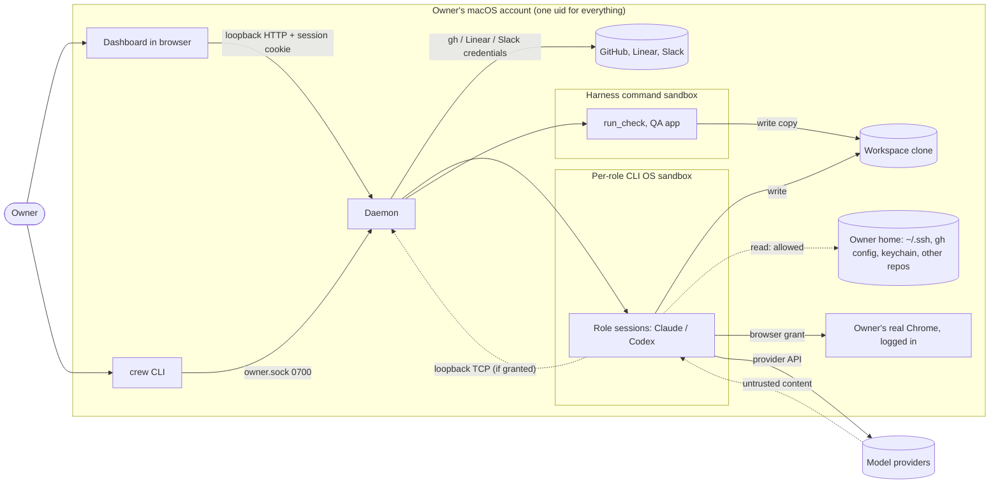
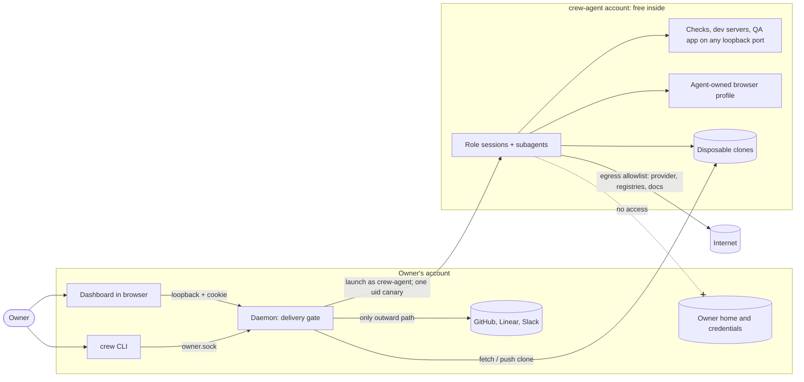

# Sandboxing review: is it worth its complexity?

Date: 2026-10-31. Version: `crew-assistant` v0.66.0 plus the owner-socket
change (`fcfd931`), which pins `lib-agent-harness` v0.24.0;
the harness itself was at v0.29.0. Task and decision counts come from a daemon
state snapshot whose last entries were dated 2026-10-08. Web sources were
read on 2026-10-31.

## The answer

Partly. Three parts were worth what they cost, and those parts are cheap: a
disposable workspace clone, outward actions (push, PRs, Linear, Slack) only
through the daemon's delivery gate, and no owner credentials in a role's
environment. The fine-grained layer built on top was not worth it. That layer
covered per-engine loopback proofs, selected-port and interface-bind canaries,
process-inspection proofs, required-skip accounting, read allow-lists,
access-request policies and the planned "sandbox edge". As of this review it
made up about 31% of the harness's Go code. It produced 87 owner decisions in
six days saying the team "can't meet this from its sandbox". It let bugs
skip past the team's checks and fail at the owner's release check, and it
stalled the crew for about seven hours. The largest real risk was still open:
every role ran as the owner's macOS account, could read the owner's
credentials and tokens, and could be handed the owner's logged-in Chrome. The
recommendation is to swap the fine-grained layer for **one coarse boundary**:
roles run as a separate macOS user that holds no owner credentials, works
only in disposable clones, and is otherwise free (localhost, subagents, a
running app, package installs through a registry allowlist). Outward actions
stay with the daemon.

## Why sandbox at all

The owner wrote the briefs, so the owner was never the adversary. Two things
were:

1. **The models' own mistakes.** Coding agents have deleted real data:
   Replit's agent dropped a production database during a code freeze in July
   2025 ([Fortune](https://fortune.com/2025/07/23/ai-coding-tool-replit-wiped-database-called-it-a-catastrophic-failure/)).
   Gemini CLI destroyed a user's files after a `mkdir` failed silently
   ([AIID 1178](https://incidentdatabase.ai/cite/1178)). Claude Code ran an
   `rm -rf` that reached a home directory
   ([Willison, Dec 2025](https://simonwillison.net/2025/Dec/9/claude/)).
2. **Content the roles read, which the owner didn't write.** Examples are web
   pages the researcher fetched, dependency code and READMEs, review threads
   on PRs from outsiders, and package install scripts. Willison's *lethal
   trifecta* is private data, plus untrusted content, plus a way to
   communicate out. When all three meet, a prompt injection can exfiltrate.
   The only reliable defence is to break one leg; detection that is 95%
   accurate is "a failing grade"
   ([Willison](https://simonwillison.net/2025/Jun/16/the-lethal-trifecta/)).
   Several real attacks fit this shape:
   - The Nx "s1ngularity" packages ran `claude --dangerously-skip-permissions`,
     `gemini --yolo` and `q --trust-all-tools` from a postinstall script to
     hunt for secrets
     ([Snyk](https://snyk.io/blog/weaponizing-ai-coding-agents-for-malware-in-the-nx-malicious-package)).
   - The Shai-Hulud worm harvested npm and GitHub tokens
     ([Help Net Security](https://www.helpnetsecurity.com/2025/09/16/self-replicating-worm-hits-180-npm-packages-in-largely-automated-supply-chain-attack/)).
   - A malicious public issue made a GitHub MCP agent leak a private repo into
     a public PR
     ([Invariant Labs](https://invariantlabs.ai/blog/mcp-github-vulnerability)).

Both threats are real for this tool. Its roles run unattended for hours,
read outside content, and run the project's checks, which can include
install scripts. So the question was never whether to have a boundary. It
was how fine-grained the boundary should be, and which leg of the trifecta to
cut.

## What existed

**Rules.** AGENTS.md ("Architecture and boundaries") required every role to
run under its CLI's OS sandbox with workspace-only writes and no network. A
role whose sandbox couldn't be confirmed was refused. Reads outside the
workspace were an accepted trade-off. The project check ran through the
daemon-hosted `run_check` command sandbox. Localhost was allowed only where
the harness proved it. The browser was the owner's real Chrome, granted per
member. Sources were `decisions/2026-09-role-sandbox-trust.md` (65 lines),
`reference/2026-09-23-cli-sandboxes.md` (131) and
`decisions/2026-10-owner-socket.md` (57). Nineteen design docs in this repo
mentioned the sandbox.

**lib-agent-harness (at v0.29.0):**

| Area | Size |
|---|---|
| `sandbox/` package | 18.4k Go lines |
| `session/` sandbox, loopback, probe and command-sandbox files | 6.3k |
| `process/` | 2.0k |
| All sandbox, loopback, probe and capability files, tests included | 27.7k of 90.3k Go lines (31%); 15.7k of them tests |
| Design docs (sandboxed sessions, command sandbox, sandbox package, loopback, selected ports, process inspection) | about 2,350 lines, plus a 148-line `SANDBOX-HANDOVER.md` |
| `testdata/support.golden` (the snapshot of support claims) | 5,280 lines |
| Commits matching `sandbox\|loopback\|canary\|seatbelt\|bubblewrap\|confine` | 51 of 318 |
| Tags whose headline was sandbox work | about 13 of 45 (v0.10, v0.14.1–2, v0.17, v0.18, v0.21–v0.24) |

Three of those releases only restored abilities the sandbox had taken away:
v0.23.1 restored developer tools picked with `xcode-select`, v0.23.2
restored `git init` in TMPDIR, and v0.23.3 restored the `uname` sysctls that
Node needs, without which npm checks aborted.

**crew-assistant:** `internal/work/runcheck.go` (287 lines),
`apphosting.go` (173), `internal/cli/owner_socket.go` (48), and
`internal/checktest` (916, including the skip and known-skip accounting).
Across the code, 229 non-test lines in 50 files and 428 test lines in 65
files mentioned the sandbox, loopback or localhost. 10 of 630 commits matched
the pattern above. Those were squashed PRs, so the count understates the
effort.

**Work queue.** About 46 of the 176 tasks in these two projects concerned
sandboxing, counted by hand after a regex pass. That was 13 in crew-assistant
and 33 of the harness's 48, roughly two-thirds of all harness work. The open
ones:

- **crew-assistant:** CA-78, CA-79, CA-80, CA-95, CA-96, CA-112, CA-120,
  plus hosted-check upkeep in CA-122, CA-123 and CA-126.
- **harness:** LAH-21, LAH-22, LAH-31 (in review), LAH-35, LAH-45, LAH-46,
  LAH-48.

Most of these waited on another sandbox task:

- CA-96 waited on LAH-29's release, and CA-95 waited on CA-96.
- CA-112 (subagents) waited on LAH-35 (proving that subagents inherit the
  sandbox).
- CA-80 (folder requests) waited on LAH-21 and LAH-22.
- CA-120 waited on LAH-39.
- CA-79 (localhost for all roles) waited on CA-78.
- The owner stopped LAH-38.

### What it cost the teams

The owner said the teammates should not be crippled, so lost capability
counts as a first-class cost. Of 410 owner decisions, **87 (21%) were "has a
requirement the team can't meet from its sandbox"**. All of them were raised
between 2026-09-30 and 2026-10-05. Their reasons overlapped:

| Reason | Decisions |
|---|---|
| Couldn't bind or listen on loopback (httptest, a dev server, `python -m http.server`) | 43 |
| Only CI or an unsandboxed run could do it | 39 |
| Needed the network or a live API | 30 |
| Needed a visual or browser check | 11 |
| Needed process groups or process inspection | 9 |
| Needed a real signed-in CLI session | 6 |

Each one turned a team requirement into an owner step.

The daemon-hosted check (CA-62, CA-92) later cut the loopback class. It
cost a second sandbox to maintain. Other costs, as recorded:

- **Bugs got past the team (CA-92).** Three times on 2026-10-04, tests that
  needed loopback, process inspection or exec skipped in the team's sandbox
  and failed first at the owner's release check. The sandbox hid the very
  failures the team existed to catch.
- **A seven-hour stall (LAH-44).** On 2026-10-05 a killed QA check left 271
  read-only folders in the command sandboxes. Every sweep failed on them, so
  claims stayed held across restarts and the crew stood still for about
  seven hours.
- **A proof that couldn't hold (LAH-39).** Seatbelt cannot confine binds to
  loopback on macOS, so the "local only" claim that the selected-port work
  aimed for was not achievable. LAH-43 ended up as test-only code proving
  that it still can't be done.
- **Skip machinery.** Tests skip when the sandbox refuses something, those
  skips are counted as required, and the known-skip exception table names
  LAH-29 (process inspection) until CA-95 lands.
- **No subagents** for any role (LAH-35), **no localhost** for the
  researcher, designer, reviewer or PM (CA-79), and the check timing out in
  the hosted sandbox (CA-126).

## Threat model, honestly

| Threat | Likelihood | Impact | What stopped it as of v0.66.0 | What a coarse boundary would do |
|---|---|---|---|---|
| (a) Model mistake: `rm -rf`, force-push, editing another repo, deleting the owner's files | Medium. It has happened to others | High outside the clone, low inside | Workspace-only writes (OS sandbox); only the daemon pushes | A separate user can't write the owner's home or other repos at all. Inside the clone, damage is disposable |
| (b) Prompt injection from fetched pages, dependency files or PR threads | Medium and rising | Depends on what's in reach | No shell network, but **reads unrestricted**; the provider channel and the content of commits and PRs stay open | Removes the "private data" leg: nothing of the owner's to read |
| (c) Credential theft: gh token, SSH keys, API keys, cookies in the owner's Chrome | Low to medium, but this is what attackers target | Very high | Nothing for reads. Codex's `:root` read and the Claude shell could list `~/.ssh` (`reference/2026-09-23-cli-sandboxes.md`). The browser grant hands over the owner's logged-in Chrome | A separate uid can't read the owner's files or keychain. The browser becomes the agent user's own profile |
| (d) Supply chain: postinstall scripts run by checks | Low to medium | High if secrets are reachable | No network in checks, so installs mostly fail. That blocks legitimate work too | Installs work through a registry allowlist, and a malicious script finds no secrets |
| (e) Acting as the owner through the daemon API (the CA-78 class) | Low | High | Owner socket (new); CA-78 open | A different uid can't read the owner's 0700 runtime directory. CA-78 is still needed for the Tailscale header |

The one complete trifecta was (c) combined with the browser grant. That
grant gave untrusted content, the owner's logged-in sessions, and a
navigation channel to the same turn. None of the loopback, port or
process-inspection work touched it. Most of the effort went into risks that
were small for a solo tool.

## What others do

- **Anthropic** shipped `sandbox-runtime`: Seatbelt or bubblewrap, plus a
  domain-allowlist proxy. Sandboxing cut permission prompts by 84%
  ([engineering post](https://www.anthropic.com/engineering/claude-code-sandboxing),
  [srt](https://github.com/anthropic-experimental/sandbox-runtime)). The docs
  say that skip-permissions sessions should run "inside a container, a VM, or
  the sandbox runtime", and that any boundary that lets traffic out can still
  leak what the agent can read
  ([sandbox environments](https://code.claude.com/docs/en/sandbox-environments)).
  The devcontainer guide advises against mounting `~/.ssh` or cloud
  credentials ([devcontainer](https://code.claude.com/docs/en/devcontainer)).
  Claude Code's Bash sandbox doesn't cover file tools, MCP or hooks
  ([sandboxing](https://code.claude.com/docs/en/sandboxing)).
- **OpenAI Codex** offers read-only, workspace-write (network off by
  default) and full access. It uses Seatbelt on macOS and bubblewrap plus
  seccomp on Linux
  ([approvals and security](https://learn.chatgpt.com/docs/agent-approvals-security)).
- **Coarse isolation.** Docker Sandboxes ran each agent in a microVM with
  only the workspace mounted
  ([Docker](https://www.docker.com/blog/docker-sandboxes-run-claude-code-and-other-coding-agents-unsupervised-but-safely/)).
  Willison: "The only solution that's credible is to run coding agents in a
  sandbox", with network control as the leg that matters most
  ([Living dangerously](https://simonwillison.net/2025/Oct/22/living-dangerously-with-claude/)).
- **Auto mode.** Anthropic called sandboxing "safe but high-maintenance".
  Its classifier missed 17% of overeager actions
  ([auto mode](https://www.anthropic.com/engineering/claude-code-auto-mode)).
- **Overkill?** No credible source argued that a solo developer needs no
  boundary. What sources did agree on was that the boundary should be
  coarse, with no secrets inside it.
- **Couldn't verify:** the separate-user tools (SandVault, Hazmat) appeared
  only in aggregator listings; the 2026 "Comment and Control" GitHub Actions
  token leaks had only secondary reports; and a 2026 Context7 MCP CVE was
  reported, but its NVD page would not load.

## Options

| | Option | Cost | Benefit | Agent capability |
|---|---|---|---|---|
| 1 | Use each CLI's own sandbox with defaults; drop the proofs and canaries | Lowest | Little. Claude's sandbox is off by default and doesn't cover its file tools; Codex's `:workspace` profile writes `/tmp` and ignores network overrides; reads stay open | Mixed: Codex still has no loopback |
| 2 | Freeze the current model and accept the documented gaps | Low now, but the 87-decision friction and the second sandbox stay | Keeps today's protection | Stays crippled: no localhost for most roles, no subagents, skips |
| 3 | **One coarse boundary**: a separate macOS user (or a VM or Docker Sandbox) with only clones and provider logins; free inside | Moderate, one-off | Closes (a), (c), (d) and (e) at the uid level and removes the private-data leg of (b) | Full: localhost, ports, subagents, the app, package installs, a browser of its own |
| 4 | Keep going fine-grained (LAH-21, LAH-22, LAH-31, LAH-35, LAH-45, CA-79, CA-80) | High and ongoing: each CLI release can break a canary | Narrow gains; (c) stays half-open while uids are shared | Each capability comes back only after its own proof |

**Recommendation: option 3, using a separate macOS user.** It keeps the
native toolchain: Xcode tools, launchd and Homebrew tests, and Seatbelt where
it's still wanted. A Linux VM would lose those. Docker Sandboxes or a VM
remain a later upgrade if network isolation needs to be stronger.

The recommended shape:

- **The daemon stays the owner's.** It holds the gh, Linear and Slack
  credentials and does every outward action through the delivery gate:
  review, QA, the landing policy and owner decisions.
- **Roles run as `crew-agent`.** The daemon launches them through a narrow
  `sudo -n -u` rule or a per-user launchd helper. Clones belong to
  `crew-agent`, and the owner gets group access to them. The only secrets in
  reach are the agent user's own provider logins.
- **Inside the boundary, roles are free.** They get loopback, any ports,
  subagents, and `make check` run directly instead of in the hosted
  sandbox. The app runs as `crew-agent`. The browser is a Chrome or
  Playwright profile owned by the agent user, never the owner's.
- **Network leaves through an allowlist.** The provider, package registries
  and documentation hosts are allowed, using the CLI's own domain allowlist
  or `srt`. Writes in the OS sandbox stay limited to the workspace as cheap
  insurance against (a).
- **One coarse fail-closed check.** Before a role starts, confirm that it
  runs as `crew-agent` and cannot read a canary file in the owner's home.
  That replaces dozens of fine-grained proofs.

**Relax now, before the move:**

- Localhost for every role (CA-79's goal, without per-task grant decisions).
  This is safe enough once the owner socket lands, because Tailscale is off.
- Subagents per member, given that Claude's subagents run in the same
  sandboxed process. That is an assumption, not a proof.
- Delete the process-inspection known skips by running those tests as the
  owner's check.

Opening the network is the exception: it should wait for the uid move.
While roles can still read the owner's credentials, network access would
complete the trifecta.

### Queued work

| Task | Verdict |
|---|---|
| LAH-21 read allow-list, LAH-22 path requests, CA-80 access-request policy | **Drop.** The uid boundary replaces them |
| LAH-31 and LAH-45 sandbox edge with provider egress, LAH-38 | **Drop.** Replace with "launch a session as a given user" in the harness |
| LAH-35 subagent inheritance proof | **Drop.** CA-112 goes ahead without it |
| LAH-46 `kern.procargs2`, CA-120 per-platform localhost semantics | **Drop.** Moot once the uid is separate and loopback is open |
| CA-95 and CA-96 process-inspection adoption | **Replace** with "run the full check as the agent user; remove the known-skip and required-skip machinery" |
| CA-79 localhost per role | **Replace** with localhost for all roles by default |
| CA-78 Tailscale header forgery | **Keep.** Another uid can still reach loopback TCP |
| CA-112 subagents | **Keep, simplified** |
| CA-126 hosted check timing out, CA-122 unreclaimable commands | **Keep only until the hosted check is retired**, then drop |
| CA-123 coverage evidence beyond the output tail | **Keep.** It isn't sandbox-specific |
| LAH-48 Linux timeout tests | **Finish** if it's close, then freeze the `sandbox` package |
| New | Agent user and launch path; one uid canary; an agent-owned browser profile; an egress allowlist decision |

The harness's existing `sandbox` package would not need deleting. Its other
consumers could keep it, frozen. crew-assistant would stop depending on its
proofs.

## Diagrams

### As of v0.66.0

### Recommended

